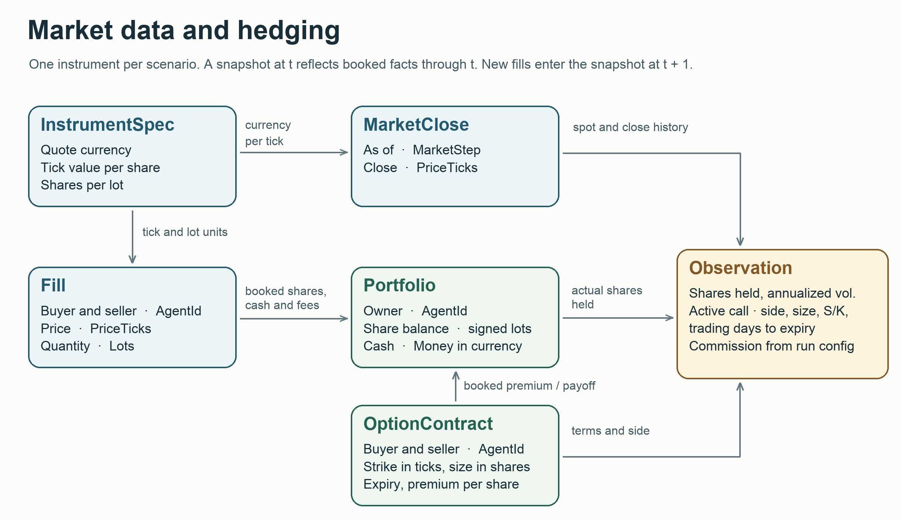

# Rust market simulator

Architecture proposal for issue #2. One Rust library runs one interactive, single-instrument market per scenario. Trading agents share an auction. All hedging policies share the same execution and accounting rules.

## 1. Project structure

Proposed source tree, relative to the repository root:

~~~text
Cargo.toml                         Cargo workspace
crates/market-sim/
├── Cargo.toml
├── src/
│   ├── lib.rs                     Public API and wiring for the default run
│   ├── domain/
│   │   ├── mod.rs
│   │   ├── units.rs               Shared IDs, quantities, money and time
│   │   ├── agents.rs              Agent population and background demand
│   │   ├── hedging.rs             Observations, targets and HedgingPolicy
│   │   ├── market.rs              Instrument terms, orders, fills and auction
│   │   └── accounting.rs          Portfolios, calls and cash postings
│   ├── application/
│   │   ├── mod.rs
│   │   ├── scenario.rs            Typed configuration for a single run
│   │   ├── simulation.rs          Snapshot assembly and trading-day sequence
│   │   └── ports.rs               ShockSource and JournalSink traits
│   └── infrastructure/
│       ├── mod.rs
│       ├── config.rs              Decode simulation-config.json
│       ├── shocks.rs              Generate seeded, addressable shocks
│       ├── journal.rs             Persist completed trading days
│       └── neural_policy.rs       Batched model runtime for issue #14
├── tests/
│   ├── trading_day.rs             Public API and hand-calculated cash flows
│   └── replay.rs                  Reproducibility across policies and runs
└── benches/
    └── scenario.rs                Complete scenario with its normal journal
~~~

**Domain.** Hedging owns the decision about how many shares to hold. Market owns order admission, auction rules, closing prices and observed volatility. Accounting owns balances and the option lifecycle. The agent population holds four cohorts and their private state. Place a value object beside its owner. For example, `Moneyness` belongs in `domain::hedging`, while the shared quantity `Shares` belongs in `domain::units`.

**Application.** `Simulation` runs a scenario and coordinates one trading day. It assembles immutable observations, calls the policy, submits orders, requests settlement and publishes the completed day. It requests each shock by its address and sends the completed record to the journal port.

**Infrastructure.** The configuration reader constructs a typed scenario. The shock generator and journal writer implement the application ports. The neural adapter implements the domain's `HedgingPolicy` using the model runtime. Classical policies can implement the same trait using pure Rust calculations.

Arrows show Rust dependency direction. The library entry point wires concrete adapters when constructing a default run.

~~~text
application                  → domain
infrastructure::config       → application::scenario
infrastructure::shocks       → application::ports
infrastructure::journal      → application::ports
infrastructure::neural_policy → domain::hedging
~~~

## 2. Data relationships

[Editable Excalidraw diagram](market-data.excalidraw)

The proposed policy API uses one input and one output slot per hedger. Simulation maintains the same stable agent order in both slices. A policy reports an error if it cannot produce the complete batch.

~~~rust
pub struct Observation {
    pub as_of: MarketStep,
    pub shares_held: Shares,
    pub annualized_volatility: AnnualizedVolatility,
    pub commission: OneWayCommissionRate,
    pub call: Option<CallObservation>,
}

pub struct CallObservation {
    pub moneyness: Moneyness,
    pub time_to_expiry: TradingDays,
    pub underlying_exposure: CallExposure,
}

pub enum CallExposure {
    Long(ContractSize),
    Short(ContractSize),
}

pub struct TargetPosition {
    pub target_shares: Shares,
}

pub trait HedgingPolicy {
    fn targets(
        &self,
        observations: &[Observation],
        targets: &mut [TargetPosition],
    ) -> Result<(), PolicyError>;
}
~~~

The excerpt shows the proposed public interface. Fixed pricing inputs, including the rate, dividend convention and day count, are available when constructing each policy. This observation covers one managed call per hedger. Each contract records its actual counterparties.

**Instrument and balances.** An immutable `InstrumentSpec` gives the monetary value of one price tick per share and the number of shares per lot. Its tick value carries the quote currency. All market batches inherit that instrument. Each `Portfolio` records signed net lots and a cash balance. The observation builder converts net lots to `Shares`. A fill carries positive lots and identifies both counterparties.

~~~rust
pub struct InstrumentSpec {
    pub tick_value_per_share: TickValuePerShare,
    pub lot_size: LotSize,
}

pub struct Money {
    currency: CurrencyId,
    amount: CashUnits,
}

pub struct OptionContract {
    id: ContractId,
    buyer: AgentId,
    seller: AgentId,
    size: ContractSize,
    strike: PriceTicks,
    premium_per_share: PremiumPerShare,
    issued_at: MarketStep,
    expires_at: MarketStep,
}
~~~

`TickValuePerShare` wraps a positive monetary value. `LotSize` is the minimum tradable increment in shares. `ContractSize` is the underlying quantity covered by the call. The contract constructor checks distinct counterparties and requires expiry after issuance.

**Time and prices.** `MarketStep` identifies an instant. `TradingDays` measures a duration. `GrossReturn` is the ratio of consecutive closing prices. `Moneyness` is the current close divided by the active strike. A roll resets the strike reference. The auction and call settlement retain an absolute price scale.

**Currency and valuation.** `Money` carries a signed fixed-point amount and its currency. The scenario fixes accounting precision and rounding. A dated FX quote expresses units of quote currency per unit of base currency. A reporting conversion uses the quote available at valuation time. An actual currency exchange books both cash legs at its execution rate. Historical entries retain their original amounts. The initial scenario settles in the instrument's quote currency.

**Numeric invariants.** Private newtype fields control construction. Shares may be fractional and signed. Order lots and traded price ticks are positive integers. A contract size is positive. A one-way commission rate and annualized volatility must be finite and nonnegative. A funding rate can be negative.

## 3. Solution blueprint

### One trading day

`application::simulation` owns the following sequence. Each financial calculation runs in its owning domain module. The application passes the completed record to `JournalSink` for publication.

1. **Observe at close t.** Read the last committed close, observed volatility, actual holdings and active calls. Derive moneyness from that close and each call's strike.
2. **Decide.** Fundamentalists, trend traders and noise traders produce limit-order intentions from their own signals. All hedgers call the same policy interface as a batch. Every decision uses information available at t.
3. **Build orders.** For a hedger, subtract actual holdings from its absolute target. Apply the common lot, limit-price and risk rules. All four cohorts enter the same auction.
4. **Clear at t+1.** Select one price and allocate eligible volume under a deterministic tie rule. Emit one two-sided fill per match. On a day without fills, carry forward the previous close.
5. **Book and settle.** Book actual fills, transfer shares and cash, and credit the commission account. Calculate funding for the elapsed interval using the opening cash balances. Settle expiring calls once at the new close. Transfer premiums on scheduled new issues. Preserve each portfolio across rolls.
6. **Commit the day.** Update return and observed volatility. Publish the close, fills, postings and aggregates together under the same step. A failed calculation leaves the last completed day available. Metrics exclude burn-in while the state continues through it.

For the first integration fixture, take two shares held and a five-share target. The buy order covers three shares. Suppose one share fills at 100 with a one-way fee of 0.001. The buyer pays 100.10, the seller receives 99.90, and the fee account receives 0.20. The next observation contains three shares. A small journal must reproduce each amount.

### Execution and checks

- Allocate dense portfolio storage by `AgentId`. Reuse order, fill and inference buffers across days. Batch the 40 hedgers. Parallelize independent scenarios.
- Address external shocks by market seed, step, agent, shock kind and draw index. The number of orders submitted by a policy cannot shift another policy's external shocks.
- Domain unit tests live beside each rule. They cover constructors, auction ties, partial allocation, empty auctions, fees, funding, settlement and rolls. Integration tests exercise the public API with fixed shocks and a journal captured in memory. They check conservation, reconstruction, observation timing and repeated runs.
- The proposed coverage gate is 100% of production Rust lines and functions across unit and integration tests. Benchmark a release build with 200 agents, 500 burn-in days and 2,000 observed days. Report measured wall time and throughput.

### Delivery order

Agree on the contracts in #2. Build the auction in #6 after #1 and #2. Develop the population in #7 and accounting in #8 as parallel consumers of the auction contract. Accounting also depends on the financial reference in #5. Integrate all four policies in #14 after #7, #8, #10 and #12. Use one feature branch and one PR per issue. A future PyO3 adapter can call the public simulation API.

**Decisions for #2 review.** Select tick size, lot size, cash precision and rounding. Agree on funding and position limits, call counterparties, staggered issuance and terminal valuation. Fix the auction tie and partial-allocation examples with #6. These choices determine whether the Rust engine and the training environment produce matching financial results.

The workflow and acceptance criteria come from the team's [interface issue](https://github.com/incRED1bl/Deep-Hedging-and-Market-Stability-Neural-vs.-Classical-Option-Hedging-in-an-Agent-Based-Market/issues/2), [accounting issue](https://github.com/incRED1bl/Deep-Hedging-and-Market-Stability-Neural-vs.-Classical-Option-Hedging-in-an-Agent-Based-Market/issues/8) and [integration issue](https://github.com/incRED1bl/Deep-Hedging-and-Market-Stability-Neural-vs.-Classical-Option-Hedging-in-an-Agent-Based-Market/issues/14). The value-object design follows the [DDD guidance](https://github.com/Sairyss/domain-driven-hexagon#value-objects) and the [Rust newtype pattern](https://rust-unofficial.github.io/patterns/patterns/behavioural/newtype.html).
