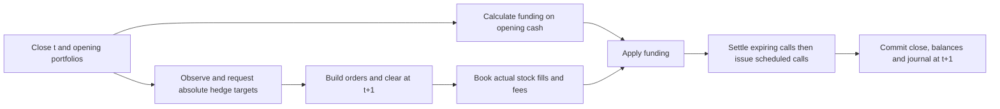

# Rust scenario contracts

The [architecture blueprint](blueprint.md) describes module ownership. This document fixes the interface and working financial conventions for the first simulator implementation. The research protocol and team review can still change the fixture values and conventions.

## Configuration and units

The [version 1 JSON fixture](../../crates/market-sim/tests/fixtures/simulation-config.json) is accepted by `market_sim::infrastructure::config::parse_scenario`. The reader rejects unknown fields and schema versions. Each run has one instrument and one quote currency.

| Input or value | Unit and fixture |
| --- | --- |
| Close, strike and limit | Positive integer price ticks. One tick per share is one USD cent in the fixture. |
| Order and fill quantity | Positive integer lots. The fixture uses one share per lot. Lot sizes can use increments of one millionth of a share. |
| Stock holdings and policy target | Signed integer lots in the portfolio. Signed, finite shares in an observation or target. |
| Call size | Positive integer whole shares of underlying exposure. |
| Cash, premium and tick value | Fixed-point quote currency. The fixture uses signed USD cents. A premium can be zero. Tick value is positive. |
| Step and duration | Market step 0 holds the initial close. One step advances one trading day. Durations count trading days. A pricing year is 252 trading days. |
| Volatility and returns | Annualized volatility is a nonnegative fraction. Gross return is the new close divided by the previous close. Moneyness is close divided by strike. |
| Commission and funding | Rates are fractions quantized to billionths. Commission applies once to each side of a fill. Funding is a signed annual rate. |
| Position and order limits | The fixture caps an order at 100 lots and the absolute position at 1,000 lots. |
| Population and sample | 60 fundamentalists, 50 trend traders, 50 noise traders and 40 hedgers. The first 500 days are burn-in. The following 2,000 days are observed. |

The dense trading agent IDs precede three cash accounts in order of fees, funding, and the call counterparty. Portfolios can hold short stock and negative cash. Borrowing and cash earn the same simple funding rate. A positive rate credits positive opening cash and debits negative opening cash. The funding account receives the opposite posting. A negative rate reverses these signs.

## Trading day

Each hedger sees actual holdings, the last committed annualized volatility, commission and any active call at close `t`. The policy fills one absolute target per observation in the same order. A batch error fails the day. The executor compares the target with whole-lot boundaries on the instrument's share scale. It truncates the change toward zero and applies the per-order and absolute position limits. The order carries a limit price and joins the common auction. Only fills affect holdings. Residual quantities expire with the batch. A no-fill day carries the previous close forward.

The trade notional in cash units is price ticks × tick value per share × lots × shares per lot. Exact integer arithmetic precedes rounding to the nearest cash unit, with ties away from zero. Both cash legs use that same booked notional. Each fee is rounded separately from booked notional × one-way commission. Daily interest uses opening cash × annual funding rate ÷ trading days per year, rounded once per funded portfolio. Negative funding amounts follow the same rounding rule. Arithmetic overflow fails the day. Each completed record includes every cash posting and becomes visible after all steps succeed.

## European call lifecycle

The option counterparty buys each call and the assigned hedger sells it. Hedger number `i` first issues at close `i mod maturity_days`, in stable cohort order starting at zero. The fixture uses a 20-day maturity, so two of the 40 hedgers first issue on each of closes 0 through 19. A call starts at the issuance close with that close as its strike. The buyer pays the booked per-share premium times the contract size to the seller. The proposed pricing input for the premium is the issuance close, the observed annualized volatility, the configured annual funding rate and zero dividends. The shared financial reference in issue #5 will determine the reference price and discounting.

After fills and funding on expiry day, the seller pays the buyer `size × max(close − strike, 0)` in quote currency. Accounting settles each contract once. A quote at or below strike has zero payoff. After settlement, a scheduled roll issues a fresh call and books its premium. Holdings and cash carry forward. On the last close, regular expiries settle and scheduled issues are suppressed. Value all outstanding calls on that close using the financial reference, as positive assets to the buyer and negative liabilities to the seller. Terminal portfolio value includes cash, marked stock and marked live calls. Live calls do not enter completed-contract hedging error.

## One hand-calculated step

The [integration fixture](../../crates/market-sim/tests/contracts.rs) fixes the fill and the roll premium so it can check the shared contracts before the auction and pricing reference are available. At step 19, the hedger holds two shares and USD 200.00 and is short a one-share call struck at USD 99.00. The policy targets five shares. At step 20, one of the three requested shares fills at USD 100.00.

| Event | Hedger cash change | Other cash changes |
| --- | ---: | --- |
| Stock fill and commission | −100.10 | Stock seller +99.90, fee account +0.20 |
| Funding on opening cash at 0% | 0.00 | Funding account 0.00 |
| Expiring call payoff | −1.00 | Call buyer +1.00 |
| New call premium at the fixture price | +1.00 | Call buyer −1.00 |
| Closing position and cash | 3 shares and USD 99.90 | The new call expires at step 40. |

Run the example with `cargo test -p market-sim --test contracts one_step_books_actual_fill_and_expiring_call_before_roll`.
