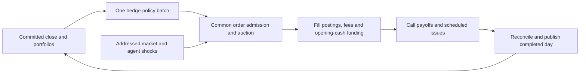

# Shared strategy integration

Black–Scholes, Leland, a no-trade band, and the prototype neural model run through one `Simulation`. Each run starts with the same market state, opening portfolios, and call phases for a given configuration.



The run starts with zero stock and 100,000 quote currency units in each trading portfolio and the call buyer's account. The fee and funding accounts start at zero. At step zero, calls issue for the first rotation phase. At each subsequent step, accounts change only through ledger postings. The published close reflects the auction, even when a particular hedger does not fill.

Every strategy receives observations in ascending hedger ID order. The simulation calls the strategy once per day with the actual holdings available at the preceding close. One `SeededShocks` source uses seed, opening step, agent, shock kind, and draw index. A change in hedge orders can change the price path while preserving those exogenous draws.

The cutoff uses closing equity on the last burn-in day after its usual call settlements and issues. Observed P&L is the terminal marked equity less that cutoff equity. Lifetime P&L is measured from the initial portfolio. The last auction settles calls due that day and values remaining calls at the final close. It does not issue additional calls.

## Policies and reference artifacts

- **Black–Scholes** uses the no-dividend call delta. The same price formula values provisional issues and marks for all four policy runs. [Black and Scholes, 1973](https://www.cs.princeton.edu/courses/archive/fall2000/cs323/resources/blackscholes.pdf)
- **Leland** applies the call adjustment `variance = sigma² + sigma × one_way_commission × sqrt(8 × trading_days_per_year / pi)`. The order still pays the configured one-way commission. [Leland, 1985](https://onlinelibrary.wiley.com/doi/10.1111/j.1540-6261.1985.tb02383.x)
- **No-trade band** keeps current holdings inside a symmetric interval centered at Black–Scholes delta × exposure. Outside the interval it targets the nearest edge. The fixture half-width is 5% of the call's underlying shares.
- **Neural model** accepts version 1 JSON with six weights per hidden unit, a hidden bias and output weight per unit, and a shared output bias. It evaluates each hidden unit across all active batch rows using a reused inference buffer. It applies tanh to the hidden units and a sigmoid to the output, then multiplies by signed hedge exposure.

The six neural input columns are log moneyness, trading years remaining, annualized volatility, held shares divided by contract size, hedge direction, and one-way commission. Hedge direction is +1 for a short call and −1 for a long call. These transforms are the prototype's normalization. The fixture has no additional trained centering or scale parameters. Every strategy targets zero stock for observations without an active call.

The [prototype weights](../../crates/market-sim/tests/fixtures/prototype-model.json) are fixture values. Final research use requires reconciliation with the financial reference in #5, the baseline rules in #10, and the trained checkpoint in #12.

## Run and inspect a scenario

```sh
fixture_dir=crates/market-sim/tests/fixtures
cargo run --release -p market-sim --example run_scenario -- \
  "$fixture_dir/integrated-scenario.json" bs /tmp/market-bs-journal
cargo run --release -p market-sim --example run_scenario -- \
  "$fixture_dir/integrated-scenario.json" neural /tmp/market-neural-journal \
  "$fixture_dir/prototype-model.json"
```

The journal path must be a new directory. Use `leland` or `band` as alternatives to `bs`. The full fixture has 200 agents, 500 burn-in days, 2,000 observed days, a 20-day call tenor, and one-hundredth-share lots.

Each committed step produces a versioned JSON file, starting at `0000000000.json`. The opening record identifies the instrument, accounting units, effective scenario settings, reserve accounts, and starting postings. Later files contain prices, returns, volatility, lots per cohort, and all fill and cash postings. Cohort lot totals are decimal strings to preserve integer precision.

Use the burn-in cutoff file for its live call marks. When burn-in is zero, the call issue prices are also the opening marks. The final file includes terminal marks plus lifetime and observed hedger P&L. The journal links each complete file into place before committing that day. On a failed publication, the prior completed market state and ledger remain available for retry.

## Checks and timing

`cargo test -p market-sim --test simulation --test policy_batch` exercises replay, batch outputs, pricing boundaries, publication failure, cutoff accounting, and common shocks.

`cargo bench -p market-sim --bench scenario` times all four policies using the full fixture and JSON disk journals. It times opening plus all trading days, excluding journal removal and compilation.

One release run on arm64 macOS with Rust 1.99.1 measured the following wall times.

| Policy | 2,500 days | Days per second |
| --- | ---: | ---: |
| Black–Scholes | 1.771 s | 1,411 |
| Leland | 1.785 s | 1,401 |
| No-trade band | 1.671 s | 1,496 |
| Prototype neural | 1.815 s | 1,378 |

The separate neural example run produced 2,501 JSON records and 220,455 fills. Its journal had finite returns and volatilities, zero net stock lots, and 40 terminal hedger results.
